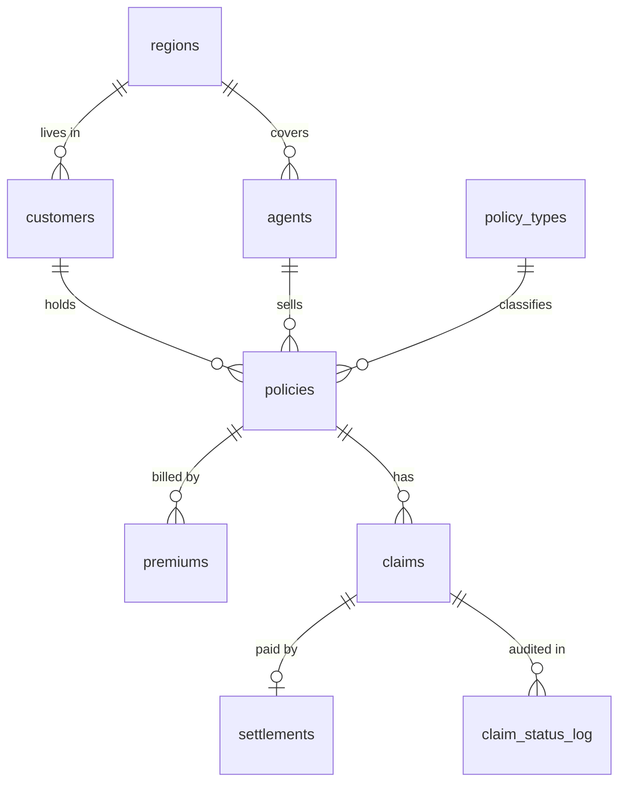

# ClaimSure - Insurance Policy and Claims Analytics

**Course:** DBMS for Analytics (25MSDA1S04) - M.Sc. Data Science, individual mini project
**Student:** B R Sahana (Reg. No. 26MSDSR057) | **Guide:** Prakash Churasia
**Problem 17 | Domain:** Insurance

A relational database (MySQL) for customers, agents, policies, premiums, claims and settlements, with SQL analytics,
Python DB-API charts of loss ratios by segment, and a MongoDB collection of claim documents with investigation notes.

## What is inside

| Folder | Content |
|---|---|
| `sql/schema.sql` | 9 tables in 3NF, 2 views, 2 triggers (MySQL 8) |
| `sql/data.sql` | 1,472 rows of sample data (817 premiums, 220 policies, 170 claims, ...) |
| `sql/queries.sql` | 10 analytical queries plus a DML demo (issue policy, pay premium, update claim) |
| `notebooks/ClaimSure_Analysis.ipynb` | Python DB-API (`mysql-connector-python`) + pandas + matplotlib |
| `mongodb/` | `claims.json` (170 docs), `mongo_operations.js` (CRUD, indexes, 4 aggregations), `load_claims.py`, `sql_vs_nosql.md` |
| `scripts/` | `generate_data.py` (seeded data generator), `build_notebook.py` |
| `docs/charts/` | PNG charts exported from the notebook |

## ER diagram



## Database features

* **3NF** - regions and policy types are separate lookup tables; settlements are split from claims (one-to-one, only for paid claims).
* **Constraints** - primary/foreign keys, UNIQUE, CHECK (positive amounts, valid date ranges), ENUM statuses.
* **Triggers**
  * `trg_claim_status_log` - logs every claim status change into `claim_status_log`.
  * `trg_settlement_marks_claim` - inserting a settlement sets the claim to SETTLED (which fires the logging trigger too).
* **Views** - `v_policy_financials` (per-policy premium / claims / settled) and `v_loss_ratio_by_type`.

## How to run

### 1. MySQL (8.0+)
```bash
mysql -u root -p < sql/schema.sql
mysql -u root -p claimsure < sql/data.sql
mysql -u root -p claimsure < sql/queries.sql
```
(or in MySQL Workbench: open each file and run it in this order.)

### 2. Python notebook
```bash
pip install -r requirements.txt
export DB_HOST=localhost DB_USER=root DB_PASSWORD=yourpassword      # Windows: set instead of export
jupyter notebook notebooks/ClaimSure_Analysis.ipynb
```

### 3. MongoDB
```bash
mongoimport --db claimsure --collection claims --jsonArray --drop --file mongodb/claims.json
mongosh --file mongodb/mongo_operations.js
```
(or `python mongodb/load_claims.py` to load with pymongo.)

### Regenerate the data (optional)
```bash
python scripts/generate_data.py      # rewrites sql/data.sql and mongodb/claims.json (seed 26057)
```

## Sample findings (from the generated data)

* Loss ratio is highest for **Motor (~83%)** and lowest for **Travel (~22%)**.
* **Central** region has the highest loss ratio (~147%) on a small premium base; East, South, West and North are 45-56%.
* Average claim-to-settlement time ranges from ~13 days (Travel) to ~94 days (Life).

## Data source
All data is **synthetic**, generated with Python (`scripts/generate_data.py`, fixed random seed 26057) using Indian
names, cities and regions, realistic premium rates per policy type, and claim amounts/settlement delays by claim type.
Rows: SQL 1,472 (regions 6, policy types 5, agents 12, customers 140, policies 220, premiums 817, claims 170,
settlements 102) plus 170 MongoDB documents. The generator is included so the data can be reproduced.

## Problem-statement checklist
| Requirement | Where |
|---|---|
| Schema for customers, policies, policy types, premiums, agents, claims, settlements (3NF, 5+ tables) | `sql/schema.sql` |
| DDL with constraints; DML for issuing policies, premium payments, claim updates | `schema.sql`; DML demo at the end of `queries.sql` |
| Claim ratio by type, avg settlement time, agent performance, lapsed policies, trigger logging claim status | `queries.sql` Q1-Q4, Q9 |
| Python DB-API analysis, loss ratio charts by segment | `notebooks/ClaimSure_Analysis.ipynb` |
| MongoDB documents, CRUD, indexes | `mongodb/mongo_operations.js` |
| Aggregation by claim type, region, outcome (2+ pipelines) + SQL vs NoSQL comparison | `mongo_operations.js` A1-A4, `sql_vs_nosql.md` |

## Tech stack
MySQL 8, MongoDB, Python 3 (mysql-connector-python, pandas, matplotlib, pymongo), Jupyter, Git/GitHub.

## Note on data
All data is synthetic (generated by `scripts/generate_data.py`) and does not describe real people or policies.
